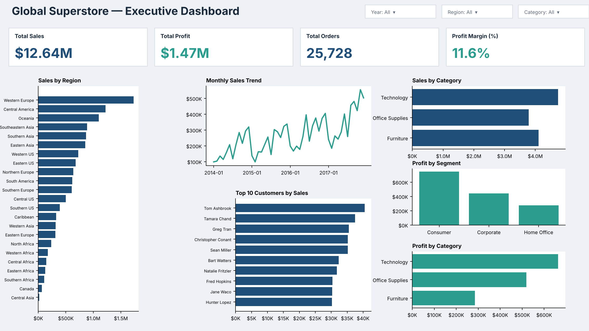

# Business Intelligence & Power BI Portfolio

A collection of Power BI experiments built around the Global Superstore dataset. The projects cover report design, business analysis, scorecards, advanced analytics, and reporting operations.

> **Dataset note:** The included Global Superstore workbook is attributed in the project documentation to the [Global Superstore dataset on Kaggle](https://www.kaggle.com/datasets/apoorvaappz/global-super-store-dataset). Review its current license and redistribution terms before reusing or redistributing the data.

## Projects

| Project | Focus | Main deliverables |
|---|---|---|
| [Experiment 5](Experiment5/README.md) | Relational and multidimensional reports, comparisons, interactive dashboard | [Power BI project](Experiment5/Experiment5.pbip) |
| [Experiment 6](Exp6_Submission/2_PowerBI_Project/Experiment6_PowerBI/README.md) | Executive dashboard and business scorecard | [Power BI project](Exp6_Submission/2_PowerBI_Project/Experiment6_PowerBI/Experiment6.pbip), [lab report (PDF)](Exp6_Submission/1_Lab_Report.pdf) |
| [Experiment 7](Exp7_Submission/4_Supporting_PowerBI_Project/Experiment7_PowerBI/README.md) | Advanced analytics and recommendations | [Power BI project](Exp7_Submission/4_Supporting_PowerBI_Project/Experiment7_PowerBI/Experiment7.pbip), [business insight report (PDF)](Exp7_Submission/1_Business_Insight_Report.pdf), [executive presentation](Exp7_Submission/2_Executive_Presentation.pptx) |
| [Experiment 8](Experiment8/output/README.md) | Reporting operations, monitoring, and requirements review | [Power BI project](Experiment8/Experiment8.pbip), [output evidence](Experiment8/output/) |

### Experiment 6 dashboard preview



Experiment 7 includes additional supporting visuals in [its output image folder](Exp7_Submission/5_Output_Images/). Experiment 8's output folder contains preview images, monitoring recommendations, and a requirements review.

## Getting started

1. Install a recent version of [Power BI Desktop](https://www.microsoft.com/power-platform/products/power-bi/desktop).
2. Clone or download this repository and open the relevant `.pbip` file from its project folder.
3. Configure the workbook path for that project:
   - **Experiments 6 and 7:** Run `Step1_Set_Data_Path.bat` from the project folder. Alternatively, set the `DataFolderPath` parameter in Power Query to that project's `Data` folder.
   - **Experiments 5 and 8:** In Power BI Desktop, open **Transform data → Manage Parameters** and update `FilePath` to the included `Global_Superstore_2018.xlsx` workbook.
4. Refresh the model in Power BI Desktop.

Keep each project folder structure intact when opening or moving a project. Experiments 6 and 7 include a setup script to update their local data path. The other projects use a file-path parameter that may need updating after cloning.

The supplied workbook contains order dates from **2014 through 2017**; the `2018` in its filename does not indicate that the dataset includes 2018 records.

## Repository layout

```text
Experiment5/       Relational, multidimensional, comparative, and interactive reports
Exp6_Submission/   Experiment 6 project, lab report, and dashboard preview
Exp7_Submission/   Experiment 7 project, business report, presentation, and visuals
Experiment8/       Experiment 8 project and monitoring/operations evidence
```

## Tools and formats

- **Power BI Desktop** — report authoring and refresh
- **PBIP, PBIR, and TMDL** — Power BI project, report, and semantic-model formats
- **Excel and CSV** — source data and scorecard targets
- **PDF, DOCX, and PPTX** — supporting reports and presentation materials

## Notes

- Some experiments contain their own copy of the source workbook so each project can be opened independently.
- Scorecard targets in Experiment 6 are illustrative and can be edited in `Data/Targets.csv`.
- Static output images are previews; they do not represent proof of a live Power BI Service refresh, schedule, or notification.
