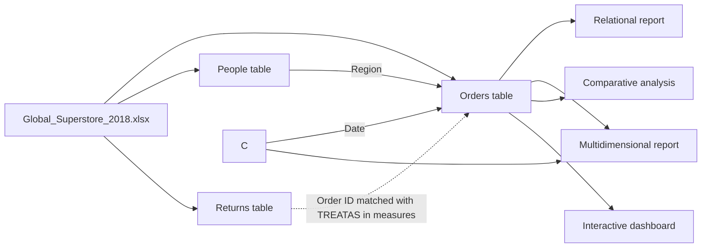

# Experiment 5 — Power BI Reports

Power BI practical for relational, multidimensional, comparative, and interactive reporting with the Global Superstore dataset.

## Project contents

- `Experiment5.pbip` — Power BI project entry point.
- `Experiment5.Report/` — four report pages and the custom theme.
- `Experiment5.SemanticModel/` — Power Query, model tables, relationships, and DAX measures.
- `Global_Superstore_2018.xlsx` — source workbook.

## Report pages

| Page | Purpose |
|---|---|
| A. Relational Report | Order-level table with Order ID, customer, product, region, sales, and profit; sorted by sales and filterable by region, category, year, and segment. |
| B. Multidimensional Report | Matrix with the Region → State → City hierarchy and Sales, Profit, and Quantity measures, plus supporting market and segment visuals. Use the matrix drill controls to expand or collapse levels. |
| C. Comparative Analysis | Sales by category, profit by region, top 10 customers by sales, and yearly sales/profit trends. |
| D. Interactive Dashboard | KPI cards, region/category/year slicers, and customer, trend, category, regional-profit, and market visuals. |

## Model and report flow

The Calendar table is generated from the Orders date range. The Returns table is used by the returned-order measures through `TREATAS`; it is not joined by a physical model relationship.

## Verified dataset results

The following baseline results were calculated from the included workbook, before report filters:

| Measure | Result |
|---|---:|
| Order-line rows | 51,290 |
| Distinct orders | 25,728 |
| Distinct customer IDs | 17,415 |
| Total sales | $12,642,501.91 |
| Total profit | $1,467,457.29 |
| Profit margin | 11.6% |
| Total quantity | 178,312 |
| Order-date range | 2014–2017 |

### Observations

- Sales increased in each year: $2.26M (2014), $2.68M (2015), $3.41M (2016), and $4.30M (2017). Sales grew 26.3% from 2016 to 2017.
- Technology had the highest category sales (about $4.74M) and profit (about $663.8K).
- Western Europe had the highest regional sales (about $1.73M) and profit (about $218.4K).
- Central Asia, Western Africa, and Western Asia had negative total profit, despite positive overall profit.
- The source has no blank values in the required report fields: Order ID, Order Date, Customer Name, Product Name, Region, Sales, Profit, Quantity, and Category.

Results shown in the report will change when slicers are applied.

## Open and refresh

1. Open `Experiment5.pbip` in Power BI Desktop.
2. The `FilePath` Power Query parameter currently points to this workstation's copy of `Global_Superstore_2018.xlsx`.
3. If the project is opened from another location or cloned from GitHub, update `FilePath` in **Transform data → Manage Parameters** to the full path of the included workbook.
4. Refresh the model and verify that the report pages populate.

The workbook is attributed to the [Global Superstore dataset on Kaggle](https://www.kaggle.com/datasets/apoorvaappz/global-super-store-dataset). Check the dataset's current license and redistribution terms before publishing the workbook in a public repository.
